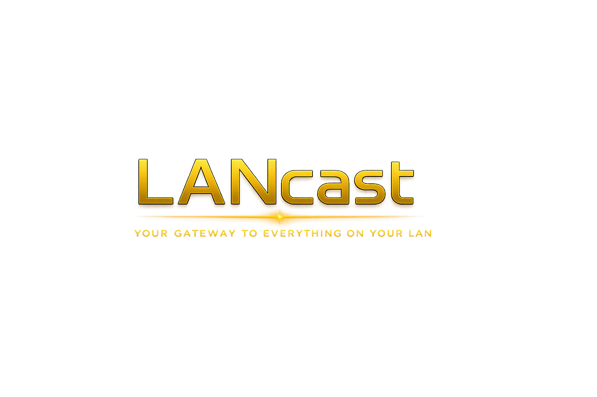
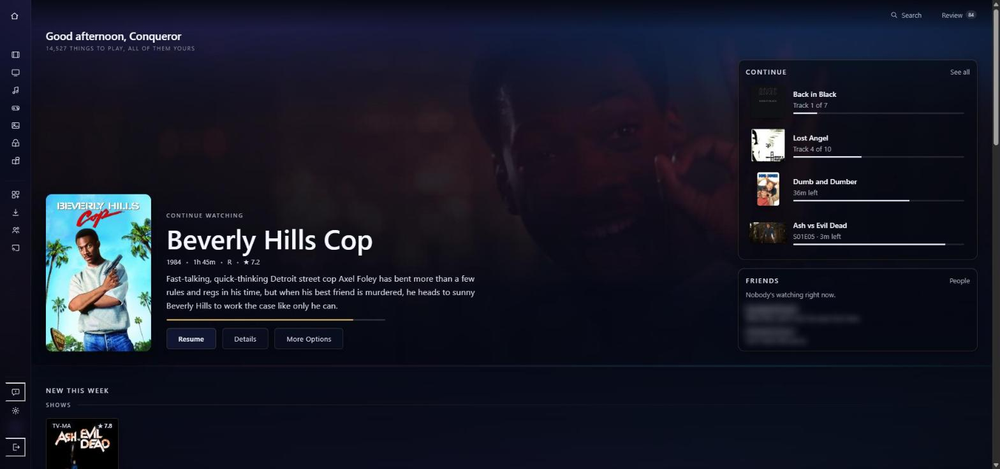
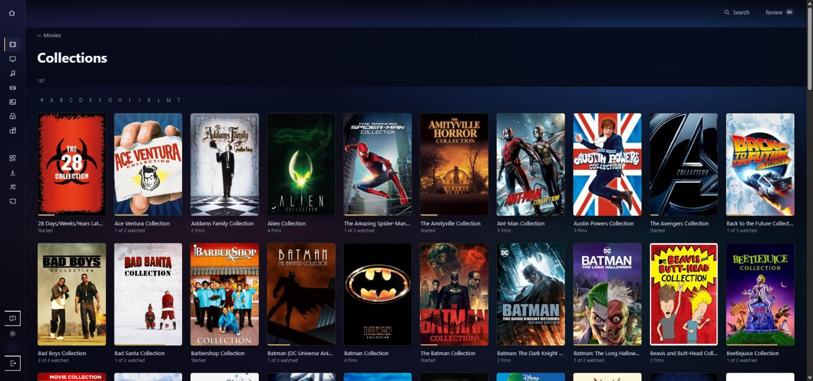
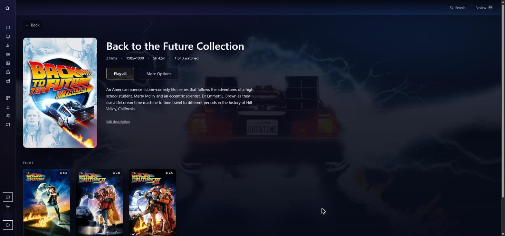
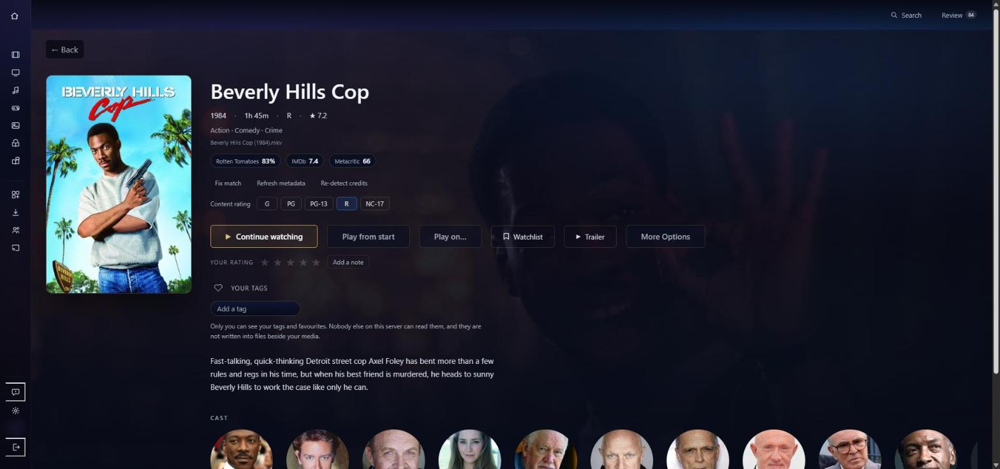
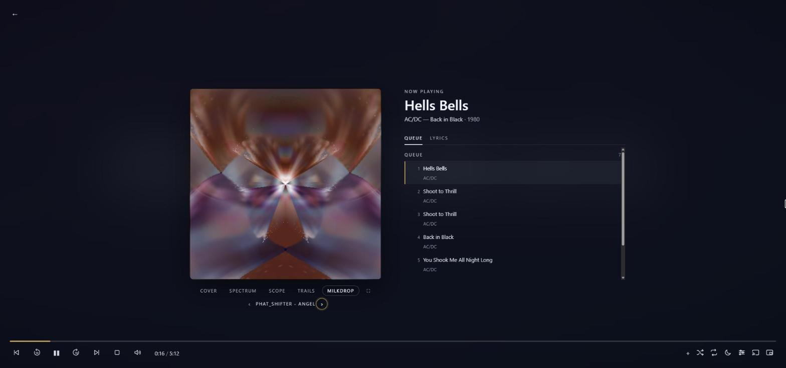
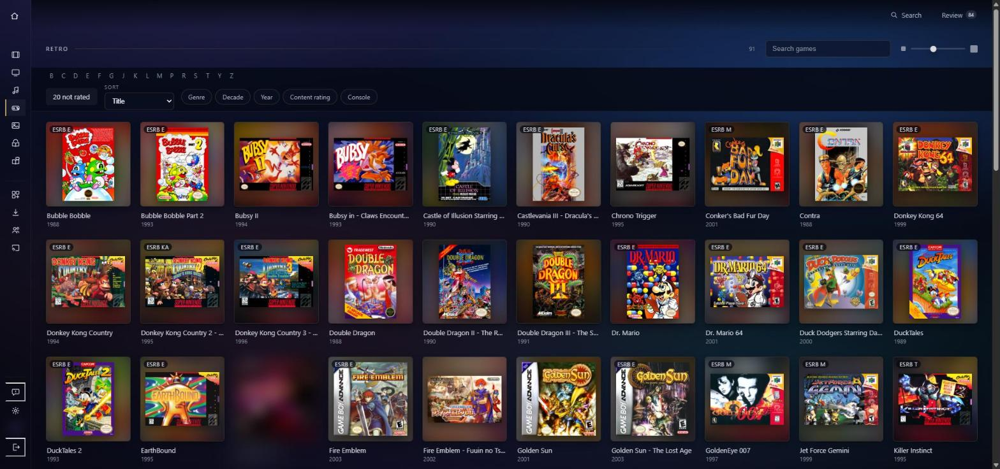

<div align="center">



**Your own media server. Films, TV, music, photos, comics, audiobooks and retro games —
on your hardware, under your control, with nothing phoning home.**

[](https://github.com/Conqueror-Mod/LANcast/releases/latest)
[](LICENSE)


[**Download**](https://github.com/Conqueror-Mod/LANcast/releases/latest) ·
[Install guide](docs/install.md) ·
[Using LANcast](#using-lancast) ·
[Security](docs/security.md) ·
[Privacy](docs/privacy.md)

</div>

> **Status: v1.0.1 · stable since 1.0.** Point it at a folder and it scans,
> identifies and plays — direct play, remux or transcode, with working seek,
> resume and hardware encoding. Every release before 1.0 is in
> [docs/history.md](docs/history.md); [docs/roadmap.md](docs/roadmap.md) is the
> honest ledger of what is left and what was *not* looked at before it shipped.

<p align="center">
  
</p>

---

## What LANcast is

Plex's streamlined polish, Kodi's customizability, and neither one's
compromises. Kodi had the right bones — everything was extensible — but never
the sustained support to stay usable. Plex arrived cleaner and better made, then
began moving free features behind a paywall and a mandatory cloud account.
Both directions cost you the same thing: control over your own library.

LANcast is one small program. Install it on the PC that holds your media, point
it at your folders, and every device in the house — and any friend you invite —
gets a fast, good-looking library that plays almost anything. No subscription,
no account with anybody, and no relay you rent.

## Highlights

### 🎬 Films and TV that look after themselves
- **Collections build themselves.** Films are grouped into their collections
  from the metadata, and a collection shows the films you *don't* own yet.
- **Intros and credits are skipped for you** — found by listening to and
  looking at the episodes themselves, not looked up in a database.
- **Your fixes stick.** Correct a title, poster or match and that field is
  locked: no refresh, rescan or merge ever touches it again.
- Up next cards, a suggestion when the film ends, chapters, scrub-bar previews,
  extras found beside the film, an optional pre-roll, and a watchlist.
- Plays almost everything directly. The desktop app plays through libmpv;
  everywhere else the server decides direct play, remux or transcode and
  **tells you why**. Hardware encoding (NVENC, Quick Sync, AMF) is chosen by a
  real test encode, not a capability list.

<p align="center">
  
  
</p>
<p align="center">
  
</p>

### 🍿 Watch Together, across the internet
- **Synchronised rooms** — pause, seek and play together, on one server.
- **Pair with a friend's LANcast** to see what they're watching and join them.
  Only the host needs to be reachable; streaming to guests is capped by the host.
- **Play on another device** — send a film or an album from your phone to the
  TV-room PC, and drive it from where you sit.
- **Invite links** that create one account, once.

### 🎵 Music, done properly
- **Visualizers** — Spectrum, Scope, Tunnel, Spiral, Smoke, Bloom, Drift, and
  full **MilkDrop presets** with their shaders.
- Gapless playback, crossfades between albums, synced lyrics, a five-band EQ,
  night mode, and loudness evened out from your files' ReplayGain.
- Album pages with a real track list, artist pages, genres, MusicBrainz album
  grouping, and a mini-player that follows you around the app.

<p align="center">
  
</p>

### 🕹️ Retro games with RetroAchievements
- Drop in your ROMs: NES, SNES, Nintendo 64, Game Boy / Color / Advance,
  Master System, Genesis and PlayStation, **identified by hash**.
- Play in the desktop app **or in a browser**. The server keeps your saves and
  save states, so you can stop on one device and carry on on another.
- **Connect your own RetroAchievements account** and earn achievements as you
  play, with pop-ups in the game.
- PC games installed on the machine show up in the same hub and launch from it.

<p align="center">
  
</p>

### 📸 Photos, 📖 comics and 🎧 audiobooks
- **Photos:** a timeline by capture date, people grouped by face, **search by
  what's in a picture**, places from GPS (off by default), duplicate and
  near-copy finding, and camera RAW files.
- **Comics:** `.cbz`, `.cb7` and `.pdf`, read a page at a time, left-to-right or
  manga order, with your place kept.
- **Audiobooks:** a book player with chapters, speed and a sleep timer.

### 👥 Built for a household
- Accounts for everyone, each with their own watch state, history and profile.
  Viewing is **private by default** and shared only if you opt in.
- Keep a library from a member, or set the highest content rating they may see.
- **Passkeys and two-factor sign-in** for anyone who wants them, and a list of
  signed-in devices you can sign out.
- DLNA for the old TV that only speaks that.

### 🛠️ Runs itself
- **Updates itself** from Settings — checked, verified and swapped in on restart.
- A live dashboard of the last two days, scheduled backups with restore,
  webhooks, Prometheus metrics, and **Report an issue**, which sends nothing
  until you press Send.
- A sandboxed **plugin runtime** (WebAssembly, deny-by-default) for anyone who
  wants to extend it — see [docs/writing-a-plugin.md](docs/writing-a-plugin.md).

## Quick start

### Windows (recommended)

1. Download **`LANcast-Setup-<version>.exe`** from the
   [latest release](https://github.com/Conqueror-Mod/LANcast/releases/latest)
   and run it.
2. Leave **Run as a Windows service** ticked if other devices should be able to
   watch while nobody is signed in to the PC. Untick it if you only watch on
   this PC.
3. Open **LANcast** from the Start menu. Create your account — the first one is
   the admin — and leave **fetch ffmpeg** ticked.
4. **Restart the server** so it listens on your network: in an Administrator
   PowerShell run `Restart-Service lancastd`, or without the service, choose
   **Exit** from the tray icon and open LANcast again.
5. Go to **Settings › Server › Libraries**, add a library, pick what kind of
   media it holds, point it at the folder, and scan.

That's it. Other devices on your network open `https://<this-pc>:8080`.

### Linux (amd64)

```bash
sudo apt install ffmpeg
tar -xzf LANcast_<version>_linux_amd64.tar.gz
sudo install -m 755 lancast /usr/local/bin/lancast
sudo lancast service install
```

The service starts on port 8080 and listens on `127.0.0.1` until an account
exists. From the computer you're sitting at, tunnel in and create it:

```bash
ssh -L 8080:127.0.0.1:8080 you@your-server
```

Open <http://localhost:8080>, create the account, then
`sudo lancast service restart` and add your libraries.

Full detail — the archive install, the data-directory rule that matters most,
ffmpeg for the service, backups and getting back in when locked out — is in
**[docs/install.md](docs/install.md)**.

| Platform | Status |
|---|---|
| Windows 10 and 11, x64 | Supported: the app, its own window, and the service |
| Linux amd64 | Supported: a systemd service, used from any browser |
| Linux arm64 (Raspberry Pi and similar) | *Built, not run* — published every release, not yet run on an arm64 machine. Reports welcome |
| macOS | Not built |

## Using LANcast

**Watching on other devices.** Any browser on your network works —
`https://<server>:8080`. LANcast makes its own certificate, so a browser warns
the first time until you trust it; the Windows app pins it and never warns.
On a phone, add the page to your home screen for an app-like window.

**Fixing a wrong match.** Open the title and choose **Fix match**, or edit any
field directly. Whatever you change is locked for good.

**Inviting a friend.** **Settings › Server › Users & access › + Invite a
friend** makes a link that creates one account, once. From there you can limit
which libraries they see and the highest rating they may watch.

**Watching together.** Press the **Watch together** button in the player to
open a room. Everyone else on your server sees it on the **People** page and
joins from there. To watch with a friend who runs their own LANcast, pair the two
servers under **Settings › Server › Other servers** — or from **Pair with a
friend** on the home page — and you'll see what each other is watching.

**Sending to another screen.** In the player, choose **Play on another
device** and pick any LANcast window signed in as you.

**Music and visualizers.** Open **Now Playing** from the mini-player and choose
a visualizer. Upload MilkDrop presets under **Settings › Server ›
Visualizers**; tune the EQ, crossfade and loudness under **Settings › This
device › Music & Now Playing**.

**Retro games and achievements.** Add a library of type **Retro games** pointed
at your ROMs. Connect RetroAchievements under **Settings › Your account › Connected
accounts**. Cores are fetched as needed; every core, its licence and its source
is listed in [docs/cores.md](docs/cores.md).

**Reaching it from outside.** Off by default, and your decision. The simplest
safe route is a VPN such as Tailscale or WireGuard. If you'd rather expose it,
give it a public name and LANcast can request a publicly trusted certificate for
it under **Settings › Server › Remote access**. Read
[docs/security.md](docs/security.md) first — never port-forward a bare
self-signed server.

**Something wrong?** **Settings › Status › Troubleshooting** shows the server
log, and **Report an issue** builds a report you can read before anything is
sent.

## Principles

These are load-bearing. Every design decision in `docs/` traces back to one.

- **Server owns truth.** Scanning, metadata, transcoding, users and playback
  state all live server-side. Headless, API-first.
- **Clients are thin.** One documented HTTP API ([docs/api.md](docs/api.md),
  [OpenAPI](docs/openapi.json)), so a third-party TV or mobile client is a
  first-class possibility rather than a fork.
- **Everything interesting is a provider.** Metadata, artwork, subtitles and
  scanners sit behind stable interfaces.
- **No phone-home.** Nothing needs the internet for the server to work, and it
  does nothing on the network you did not ask for.
  [docs/privacy.md](docs/privacy.md) lists everything it does reach, including
  the two things on by default, and what triggers each.

## Metadata and ratings

**Nothing to sign up for.** A release carries its own
[TMDB](https://www.themoviedb.org) key for posters, synopses, cast and artwork,
and its own [OpenSubtitles](https://www.opensubtitles.com) key for subtitle
search ([ADR 0110](docs/adr/0110-lancast-carries-its-own-provider-keys.md)).

**Your own key always wins** — enter one under **Settings › Server ›
Metadata**. For TMDB use the **API Key (v3 auth)**, the 32-character hex value,
not the v4 Read Access Token. Keys are stored `0600` outside the database and
are never readable back through the API.

**Or turn the built-in keys off.** LANcast then falls back to filenames and
Kodi-style `.nfo` sidecars and contacts neither service. A build from source
carries no built-in keys and behaves this way until you enter one.

**Ratings (optional).** Add a free [OMDb](https://www.omdbapi.com/apikey.aspx)
key of your own to show Rotten Tomatoes, Metacritic and IMDb scores beside the
TMDB rating. Nothing is fetched until you do, and use of the key is subject to
[OMDb's terms](https://www.omdbapi.com/legal.htm).

> This product uses the TMDB API but is not endorsed or certified by
> [TMDB](https://www.themoviedb.org).

## Security in brief

- **No account, no network.** Until the first account exists the server
  listens on `127.0.0.1` only — its API can browse the filesystem, so an open
  port with no password would be arbitrary read access.
- **HTTPS on the network.** Once it binds the network it serves HTTPS, with
  your certificate or one it makes. The Windows app pins that key.
- **Server-side sessions.** Changing a password signs out *every* session,
  including your own. CSRF is defended twice: `SameSite=Strict` and an
  `Origin` check.
- **Outside access is off by default** — see [Using LANcast](#using-lancast)
  and [docs/security.md](docs/security.md).

## What is not proven

1.0 is a promise that everything built has been seen working, or is named here
as not having been:

- **Trusted reverse proxies, Prometheus metrics and Home Assistant webhooks**
  were *checked with simulated clients* (`curl` and a local receiver, on the
  installed service), not behind a real Caddy or nginx, a real Prometheus or a
  real Home Assistant.
- **Theater output** (HDR and audio passthrough to a receiver) is *parked*
  until the hardware to test it is to hand. Frame-rate matching and uncomposed
  video, which it builds on, shipped and are in use.
- **Live TV** is built but unfinished, so it is **off** and on no screen; its
  routes answer `409 live_tv_off`. Adding `"live_tv": true` to `config.json` in
  the data directory brings it back as it was, unsupported.
- **Linux arm64** is *built, not run*.

The full record of what each release did and did not look at is
[docs/roadmap.md](docs/roadmap.md).

## Building from source

<details>
<summary><b>Requirements, build and run</b></summary>

- **Go** — `go.mod` pins the toolchain (currently Go 1.26.11); any Go from 1.21
  on fetches it for you.
- **Node 24** — only if you change the client in `web/`.
- **ffmpeg** — for probing and conversion. Without it LANcast still runs and
  serves direct-play files, and says so plainly.
- **No C toolchain.** SQLite is a pure-Go driver, so there is no cgo on any
  platform ([ADR 0001](docs/adr/0001-go-and-pure-go-sqlite.md)).

```bash
go test ./... && go run ./cmd/lancast serve -addr :8080
```

| Flag | Default | Meaning |
|---|---|---|
| `-addr` | `:8080` | Listen address |
| `-data` | `%APPDATA%\LANcast` on Windows, `~/.config/LANcast` on Linux | Where `lancast.db`, `config.json` and the logs live |
| `-v` | off | Verbose logging |

Build the one LANcast executable — the app, and the server as `LANcast serve`
([ADR 0080](docs/adr/0080-one-executable-two-roles.md)):

```bash
./build.sh
```

The client is React + TypeScript in `web/`, built by Vite and committed into
`internal/web/dist` so a built server is genuinely one file. After changing it,
run `npm --prefix web test` and `npm --prefix web run build`, and commit the
rebuilt `dist`. Before calling anything done, all three of `go test ./...`,
`go build ./...` and `npm --prefix web test` must pass.

</details>

## Documentation

| Document | What it covers |
|---|---|
| [docs/install.md](docs/install.md) | Installing a release, the service, and the data-dir rule |
| [docs/architecture.md](docs/architecture.md) | Package map, request, streaming and scan lifecycles |
| [docs/api.md](docs/api.md) | HTTP contract — the promise clients depend on |
| [docs/design.md](docs/design.md) | Visual design system, the gold rule, keyboard model |
| [docs/metadata.md](docs/metadata.md) | Providers, matching, locking, artwork |
| [docs/security.md](docs/security.md) | What is protected, what is not — **read before exposing it** |
| [docs/privacy.md](docs/privacy.md) | Everything LANcast sends beyond your network, to whom, and when |
| [docs/cores.md](docs/cores.md) | Every emulator core, its licence and its source |
| [docs/writing-a-plugin.md](docs/writing-a-plugin.md) | Building a plugin, and the two things a third party still cannot do |
| [docs/roadmap.md](docs/roadmap.md) | Every release, every area's status, and what each pass taught |
| [docs/adr/](docs/adr/) | 125 decision records — why things are the way they are |

The `*-plan.md` files in `docs/` are the plans particular areas were built
from, kept as written; the roadmap and the ADRs record what actually happened.

## License

**LANcast is © 2026 Conqueror-Mod and licensed under the
[GNU Affero General Public License, version 3](LICENSE) (AGPL-3.0-or-later).**

You may run it, study it, change it and share it. If you distribute a modified
version — **or run one as a service other people use over a network** — you must
offer those people the source of your version under the same terms. That last
clause is why this is the Affero GPL: a media server can be run for other people
without ever being *distributed*, and plain GPL would not reach it.

**A commercial licence is available** for anyone who wants to build on LANcast
without those obligations — see [COMMERCIAL.md](COMMERCIAL.md).

*Releases up to and including v0.8.44 were published under the MIT licence and
remain available under it.*

Third-party components keep their own licences — see [NOTICE](NOTICE),
[internal/webview2/LICENSE](internal/webview2/LICENSE),
[internal/webview2/PROVENANCE.md](internal/webview2/PROVENANCE.md) and
[web/vendor/hls.js/LICENSE](web/vendor/hls.js/LICENSE).
